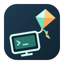

<p align="center">
  
</p>

<h1 align="center">DeskPort</h1>

> **Current desktop release: [0.7.4 (r2)](https://github.com/keithxc/deskport/releases/tag/v0.7.4).**
> The translated package examples and verification history below still describe
> 0.7.3. Use the [current installation guide](../../README.md#install) and
> [0.7.4 release notes](../releases/RELEASE_0.7.4.md) for the replacement downloads.

<p align="center">
  <a href="../../README.md">English</a> ·
  <a href="README.zh-CN.md">简体中文</a> ·
  <a href="README.zh-TW.md">繁體中文</a> ·
  <a href="README.ja.md">日本語</a> ·
  <a href="README.ko.md">한국어</a> ·
  <b>Deutsch</b> ·
  <a href="README.es.md">Español</a> ·
  <a href="README.fr.md">Français</a><br>
  <a href="README.pt-BR.md">Português (Brasil)</a> ·
  <a href="README.ru.md">Русский</a> ·
  <a href="README.it.md">Italiano</a> ·
  <a href="README.nl.md">Nederlands</a> ·
  <a href="README.pl.md">Polski</a> ·
  <a href="README.tr.md">Türkçe</a> ·
  <a href="README.uk.md">Українська</a><br>
  <a href="README.ar.md">العربية</a> ·
  <a href="README.hi.md">हिन्दी</a> ·
  <a href="README.id.md">Bahasa Indonesia</a> ·
  <a href="README.ms.md">Bahasa Melayu</a> ·
  <a href="README.th.md">ไทย</a> ·
  <a href="README.vi.md">Tiếng Việt</a> ·
  <a href="README.bo.md">བོད་ཡིག</a>
</p>

<p align="center">
  Ein Remote-Desktop-Arbeitsbereich auf Basis von Moonlight und Sunshine.<br>
  Halten Sie Ihren Remote-Desktop im Hintergrund bereit, holen Sie ihn mit einer
  Aktion in Ihren aktuellen Arbeitsbereich und blenden Sie ihn ohne erneutes Verbinden wieder aus.
</p>

<p align="center">
  <a href="https://github.com/keithxc/deskport/releases/tag/v0.7.3"></a>
  <a href="https://apps.apple.com/us/app/deskport/id6812389978"></a>
  <a href="https://github.com/keithxc/deskport/releases/download/v0.7.8/DeskPort-2.7-63.apk"></a> <del>$4.99</del>
  <a href="../../LICENSE"></a>
</p>

---

## Hauptfunktionen

- **Eine Desktop-App zum Ansehen und Freigeben.** Integriertes Sunshine, Gerätefreigabe,
  unabhängige Zugangsdaten und Einstellungen; keine separate Sunshine-Installation für die
  Host-Pakete für macOS, Windows und Linux (nicht für das reine Viewer-Flatpak).
- **Ein Arbeitsbereich, der Ihrem Client folgt.** Adaptive Größenanpassung auf kompatiblen macOS-
  und KDE-Hosts, HiDPI, Hoch-/Querformat-Layouts für Mobilgeräte und Größenanpassung pro Gerät.
  Größenänderungen verbinden das Video kurz neu; es sind keine nahtlosen Encoder-Wechsel.
- **Wählen Sie die Anzeigerichtlinie des Hosts.** Virtueller Hauptbildschirm mit gespiegelten Bildschirmen,
  virtueller Hauptbildschirm mit deaktivierten übrigen Bildschirmen oder ein erweiterter Arbeitsbereich auf
  geeigneten Hosts. DeskPort stellt das gespeicherte Layout wieder her, wenn die Sitzung endet.
- **Wechseln Sie zwischen autorisierten Geräten.** Bestätigen Sie, bevor Sie eine aktive Sitzung
  übernehmen; der verdrängte Client erhält eine authentifizierte Erklärung zur Übernahme.
- **Desktop-Arbeit in Reichweite halten.** Einen verbundenen Viewer aus- und wieder einblenden,
  Remote-Eingaben im ausgeblendeten Zustand freigeben und das Ansehen unabhängig von der lokalen Freigabe trennen.
- **Einstellungen pro Computer speichern.** Bild, Audio, Eingabe, Desktop-Feinabstimmung und Adressbearbeitung
  bleiben beim Gerät; Karten, Anheften, Designs und lokalisierte Oberflächen.
- **Desktop-Zwischenablage bei Bedarf teilen.** Text wird sofort aktualisiert;
  unterstützte Bilder und Dateien werden auf Anforderung zwischen gebundenen Desktop-Peers mit
  aktivierter Option abgerufen. Siehe [Umfang und Grenzen der Zwischenablage](../CLIPBOARD.md).
- **Native mobile Steuerung.** iPhone/iPad und der Android-Client bieten
  Touch-/Trackpad-Eingabe, Tastatursteuerung und direkten Einstieg in den Remote-Desktop.
- **Optionaler Start bei der Anmeldung und macOS-Wiederherstellung.** Diese erfordern eine aktive grafische
  Anmeldung und eine Systemfreigabe; sie entsperren weder FileVault noch melden sie Sie an.

## Oberflächenvorschau

Screenshots der aktuellen Oberfläche mit synthetischen Demo-Geräten. Klicken Sie auf ein Feld,
um das Bild in voller Größe zu sehen; diese Vorschauen implizieren keine Verfügbarkeit im Store oder als Release.

| Geräte und Gruppen | Bildschirmeinstellungen pro Gerät | Integriertes Handbuch |
| --- | --- | --- |
| [](../media/devices.png) | [](../media/device-settings.png) | [](../media/manual.png) |

## Unterstützte Plattformen

Die folgenden Links führen zum offiziellen Release 0.7.3. Paketprüfungen und Laufzeitprüfungen haben unterschiedliche Abdeckungen; Details und offene Punkte stehen im [Prüfbericht](https://github.com/keithxc/deskport/releases/download/v0.7.3/VERIFICATION.txt).

| Plattform | Rolle | Release-Status | Download |
| --- | --- | --- | --- |
| macOS Apple Silicon, macOS 26+ | Viewer + Host + native virtuelle Anzeige | **0.7.3 stabil**; Developer-ID-Signaturen, Apple-Notarisierung und Gatekeeper-Prüfung nach ZIP-Entpacken bestanden | [DMG](https://github.com/keithxc/deskport/releases/download/v0.7.3/DeskPort-0.7.3-macos-arm64.dmg) |
| Linux x86_64 | Viewer + Host; adaptiver virtueller Arbeitsbereich auf geeigneten KWin-, Mutter- und Hyprland-Hosts | **0.7.3 stabil**: DEB, RPM, Arch, AppImage, portables Archiv und Nix | [Release](https://github.com/keithxc/deskport/releases/tag/v0.7.3) · [Installationsanleitung](../LINUX_PACKAGES.md) |
| Linux x86_64 Flatpak | Nur Viewer | **0.7.3 stabil**, Freedesktop Platform 25.08 | [Release](https://github.com/keithxc/deskport/releases/tag/v0.7.3) |
| iPhone / iPad, iOS/iPadOS 15+ | Nur Client | App Store; neuere Builds werden separat in TestFlight getestet | [App Store](https://apps.apple.com/us/app/deskport/id6812389978) |
| Android 8.0+ | Nur Client | **2.7 (63)** · Geschlossener Test bei Google Play läuft | [APK herunterladen](https://github.com/keithxc/deskport/releases/download/v0.7.8/DeskPort-2.7-63.apk) |
| Windows x64 | Viewer + Host + virtuelle Anzeige | **0.7.3 stabil**; Installer mit Host; portables ZIP nur als Viewer; Paket- und CLI-Prüfungen ohne Installation bestanden; Anwendung und Installer unsigniert | [Installer](https://github.com/keithxc/deskport/releases/download/v0.7.3/DeskPort-0.7.3-windows-x64-setup-full.exe) |
| Linux ARM64 / Intel Mac | Nicht qualifiziert | Kein verifiziertes Release-Paket | — |

> **Hinweis zu Windows-Virenschutz:** Virenschutzprogramme könnten die Windows-Hilfskomponenten von DeskPort fälschlicherweise als Bedrohung melden.
> In unseren eigenen Tests ist das nicht aufgetreten. Lassen Sie Defender aktiviert; falls eine Warnung erscheint,
> lesen Sie den Release-Prüfbericht sowie die [Beispielhistorie](../WINDOWS_DEVELOPMENT.md#windows-antivirus-notice).

Native Linux-Pakete erfordern glibc 2.39+: Ubuntu 24.04+/Debian 13+, Fedora 44,
aktuelles Arch. Das AppImage bündelt eine private Laufzeitumgebung für Desktops mit älterem glibc;
Hardwaretreiber und Compositor-Unterstützung bestimmen weiterhin die Host-Fähigkeiten. KDE-Hosting mit
virtueller Anzeige benötigt Compositor-Berechtigungseinträge. Native/Nix-Pakete liefern feste Einträge; die
AppImage- und portablen Builds registrieren den aktuellen Pfad des Display-Helpers automatisch,
wenn die Freigabe startet. Host-Eingaben erfordern weiterhin Geräteberechtigungen. Mobile Apps
hosten keine Desktops.
Eine Quelldefinition oder eine erfolgreiche Kompilierung allein ist keine unterstützte Plattform.

## Installation

**macOS:** Öffnen Sie das [DMG](https://github.com/keithxc/deskport/releases/download/v0.7.3/DeskPort-0.7.3-macos-arm64.dmg),
ziehen Sie DeskPort in „Programme“ und öffnen Sie es. Erteilen Sie die Berechtigungen für Bildschirmaufnahme und
Bedienungshilfen, um Host-Funktionen zu nutzen. Nix und Homebrew werden nicht benötigt.

**Linux:** Wählen Sie das [0.7.3-Paket](https://github.com/keithxc/deskport/releases/tag/v0.7.3)
für Ihr System und folgen Sie der [Installationsanleitung](../LINUX_PACKAGES.md),
einschließlich der Berechtigungen für Host-Eingaben. Mit Nix: `nix run github:keithxc/deskport/v0.7.3`.
Flatpak bietet nur das Ansehen. Die Release-Assets enthalten [SHA-256-Prüfsummen](https://github.com/keithxc/deskport/releases/download/v0.7.3/SHA256SUMS.txt) und einen [Prüfbericht](https://github.com/keithxc/deskport/releases/download/v0.7.3/VERIFICATION.txt).

**Android 2.7 (63)** · ~~$4.99~~ · Bis zum Abschluss des geschlossenen Tests bei Google Play ist die [APK](https://github.com/keithxc/deskport/releases/download/v0.7.8/DeskPort-2.7-63.apk) vorübergehend auf GitHub verfügbar. Der Quellcode der mobilen Clients ist nicht öffentlich. Hier wird nur das Installationspaket angeboten.

Build 63 verwendet denselben Signaturschlüssel wie Google Play. Beim Update auf eine neuere Play-Version bleiben gekoppelte Computer und Einstellungen erhalten. Wer GitHub-Build 62 installiert hat, muss ihn vor der Installation von Build 63 deinstallieren. Dabei gehen lokale Einstellungen verloren und die Computer müssen erneut gekoppelt werden.

**iPhone / iPad:** Installieren Sie [DeskPort aus dem App Store](https://apps.apple.com/us/app/deskport/id6812389978).
Die mobile App ist ein kostenpflichtiger Einmalkauf; den aktuellen lokalen Preis finden Sie in Ihrem Store.
Desktop-Releases bleiben kostenlos und Open Source. Käufe unterstützen Signierung,
Testhardware und die weitere Entwicklung.

Starten Sie die Freigabe auf dem Host, wählen Sie ihn auf dem Client aus und genehmigen Sie das Gerät auf dem
Host. Beide Geräte benötigen eine funktionierende Netzwerkverbindung: Verwenden Sie ein LAN oder Ihr eigenes VPN wie
Tailscale. DeskPort bietet keinen Kontodienst, keine gehosteten Desktops, kein Relay
und keinen Netzwerktunnel. Das klassische Sunshine-PIN-Pairing bleibt verfügbar.

**0.7.3 stabil:** Diese Version bringt einen gemeinsamen UI-Katalog mit 22 Sprachen und Sprachwechsel im Browser und verbessert die Freigabe in angemeldeten Windows-Sitzungen und die DPI-Einstellungen virtueller Anzeigen, die Linux-Laufzeit und Wayland-Zwischenablage, abgesicherte Hyprland/X11-Arbeitsbereiche, die optionale lokale IME sowie quadratische Gerätekarten. Änderungen und Prüfgrenzen stehen in den [Release Notes zu 0.7.3](../releases/RELEASE_0.7.3.md).

**Prüfumfang von 0.7.3:** Unter Windows bestanden der exakte Payload-Abgleich, PE- und native CLI-Prüfungen sowie der Defender-Scan ohne Funde; Installation, GUI-Verbindung und Streaming wurden nicht geprüft. Das endgültige AppImage bestand die Bazzite-VM-Prüfung mit regulärem FUSE und Software-GPU. In der Ubuntu-26.04-VM reproduzierte das DEB von 0.7.2 den VA-Absturz; das endgültige DEB von 0.7.3 behob ihn und bestand das Upgrade. Der Rollback reproduzierte den Absturz der alten Version; die anschließende Deinstallation erhielt die synthetische Testkonfiguration. GNOME-Aufnahme und -Wiederherstellung sind weiterhin nicht abgenommen. Container-/Flatpak-Ergebnisse und weitere Grenzen stehen im [Prüfbericht](https://github.com/keithxc/deskport/releases/download/v0.7.3/VERIFICATION.txt); dies ist keine vollständige Prüfung auf physischer Hardware.

**Historisch: 0.7.2 stabil:** Das [Desktop-Release](https://github.com/keithxc/deskport/releases/tag/v0.7.2) bündelt Verbesserungen bei Größenänderung, Remote-Streaming, Datensparmodus und Linux-Laufzeit und behebt AppImage-Probleme unter Bazzite/KDE Wayland. Details in den [Release Notes zu 0.7.2](../releases/RELEASE_0.7.2.md); Installationsschritte je Linux-Distribution stehen in der [englischen README](../../README.md#linux-installation-by-distribution).

**Browserzugriff:** Desktop-Hosts stellen einen HTTPS-Remote-Desktop bereit, mit einem
30-Sekunden-Anmeldecode, optionalem Browser-Pairing für sieben Tage, adaptiver Größenanpassung
und Vollbild. Siehe die [Release Notes zu 0.7.1](../releases/RELEASE_0.7.1.md) und die
[Browser-Anleitung](../BROWSER_ACCESS.md). Das AppImage enthält eine private glibc-Laufzeitumgebung;
native Pakete behalten ihre Anforderung an glibc 2.39.

### Verfügbarkeit in Linux-Repositorys

| Kanal | Status | Installation |
| --- | --- | --- |
| GitHub-Release-Pakete | 0.7.3 stabil | Laden Sie oben das Paket für Ihre Distribution herunter |
| Upstream-Nix-Flake | 0.7.3 stabil | `nix run github:keithxc/deskport/v0.7.3` |
| AUR `deskport-bin` | Rezept getestet; Veröffentlichung durch Pausierung der Neuregistrierung von Konten blockiert | [Rezept lokal bauen](../LINUX_PACKAGES.md#arch-linux-and-aur) |
| Nixpkgs `deskport` | [PR #572043](https://github.com/NixOS/nixpkgs/pull/572043) zur Prüfung eingereicht; nicht gemergt | Bis zur Aufnahme das Upstream-Flake verwenden |
| Offizielle Arch-Repositorys / Flathub | Nicht gelistet | Release-Downloads verwenden; Flatpak ist nur ein Viewer |

Das herunterladbare Arch-Paket wird mit `pacman -U` installiert; es macht
`pacman -S deskport` nicht verfügbar. Ebenso macht das Upstream-Flake
`pkgs.deskport` in Nixpkgs nicht verfügbar. Host-Eingaben, Aufnahmeberechtigungen und Firewall-Einrichtung
sind von der Installation der Anwendung getrennt; siehe die
[Linux-Installationsanleitung](../LINUX_PACKAGES.md#nixos-and-nix).

## Vergleich mit ähnlichen Produkten

Dies ist ein Vergleich von Arbeitsabläufen und Plattformen, geprüft anhand der verlinkten offiziellen
Dokumentation am **2026-09-20**, kein Latenz- oder Bildqualitäts-Benchmark. Produktfunktionen
und Plattformgrenzen können sich ändern.

| Aspekt | DeskPort | Moonlight + Sunshine | RustDesk | Parsec |
| --- | --- | --- | --- | --- |
| Hauptarbeitsablauf | Dauerhafter Remote-Desktop-Arbeitsbereich, adaptive Größenanpassung und Geräteübergabe | Spiele-/Desktop-Streaming über separate Client- und Host-Apps | Allgemeine Fernsteuerung und Support | Interaktiver Remote-Desktop und Zusammenarbeit |
| Desktop-Host-Plattformen | macOS Apple Silicon, Linux x86_64 und Windows x64 | Windows, macOS, Linux und FreeBSD, je nach Plattformgrenzen | Windows, macOS und Linux | Windows und macOS; Linux kann nicht hosten |
| Desktop-Clients | macOS Apple Silicon, Linux x86_64 und Windows x64 | Unter anderem Windows, macOS und Linux | Windows, macOS und Linux | Windows, macOS, Linux und unterstützte Chromium-Browser |
| Mobile Clients | iPhone/iPad (App Store) · Android (GitHub APK) | iOS/iPadOS und Android | iOS/iPadOS und Android; iOS kann nicht hosten | Android; kein iOS/iPadOS-Client |
| Einrichtungsmodell | Integrierter Host in nativen Desktop-Paketen; Geräte in DeskPort genehmigen | Sunshine separat installieren und konfigurieren, dann Moonlight koppeln | Öffentliche Serverinfrastruktur oder selbst gehosteter Server | Parsec-Konto und -Anwendung |
| Netzwerk-/Dienstmodell | Eigene LAN-/VPN-Erreichbarkeit mitbringen; kein DeskPort-Relay | Selbst gehostetes Streaming; Netzwerkerreichbarkeit konfigurieren | Öffentliche Infrastruktur oder selbst gehosteter OSS-/Pro-Server | Parsec-Konto-/Dienstinfrastruktur |
| Quellcode und Vertrieb | GPL-Desktop, kostenlose Desktop-Pakete; kostenpflichtige Apple-App separat vertrieben | Open-Source-Clients und -Host | Open-Source-Client und OSS-Server; kommerzielle Pro-Server-Option | Proprietäre Anwendung/Dienst |

Quellen: [Moonlight](https://moonlight-stream.org/),
[Sunshine installation and platform support](https://docs.lizardbyte.dev/projects/sunshine/latest/md_docs_2getting__started.html),
[RustDesk clients](https://rustdesk.com/docs/en/client/),
[RustDesk self-hosting](https://rustdesk.com/docs/en/self-host/),
[Parsec platform compatibility](https://support.parsec.app/hc/en-us/articles/32381568346644-Hardware-and-Software-Compatibility),
[Parsec Linux setup](https://support.parsec.app/hc/en-us/articles/32381552552340-Install-Parsec-App-on-Linux).
Die aktuellen Plattformgrenzen von DeskPort sind oben aufgeführt; diese Tabelle impliziert weder
Funktionsgleichheit auf allen Betriebssystemen noch einen gemessenen Leistungsvorteil.

Siehe die [Release Notes zu 0.7.3](../releases/RELEASE_0.7.3.md),
die [Architektur](../ARCHITECTURE.md) und die [Roadmap](../ROADMAP.md).

## Unter Linux bauen und ausführen

Mit aktiviertem Nix und Flakes:

```sh
git clone https://github.com/keithxc/deskport.git
cd deskport
nix build
./result/bin/deskport
```

Die Quellabhängigkeiten von Drittanbietern für den Viewer sind eingebunden (vendored); der gemeinsame Kern und
die Nix-Build-Eingaben bleiben fixierte externe Abhängigkeiten. Native Builds müssen
`shared/deskport-core` initialisieren. Siehe [docs/VENDORED.md](../VENDORED.md).
Für SSH-Einrichtung, lokale Host-Verwaltung, VPS-Voraussetzungen und Omarchy/Hyprland
siehe den [CLI-Leitfaden](../CLI.md). `deskport doctor` prüft die Voraussetzungen für das Hosting;
`deskport status --json` untersucht die laufende Instanz, ohne ein Fenster zu öffnen.
`nix run . -- --help` listet die Befehlszeilenschnittstelle auf. Starten Sie die Freigabe auf dem Host und binden Sie die Geräte, bevor Sie sich verbinden. Das klassische
Sunshine-PIN-Pairing ist ebenfalls verfügbar. Es sind keine persönlichen Host- oder Pairing-Zugangsdaten
enthalten oder werden aus Moonlight importiert.
Neue manuelle Adressen verwenden standardmäßig DeskPorts Port `48989`. Geben Sie den auf der
Freigabeseite des Hosts angezeigten Port an, falls abweichend, oder verwenden Sie `host:47989`, um sich explizit
mit einer standardmäßigen eigenständigen Sunshine-Installation zu verbinden. Gespeicherte/erkannte Endpunkte behalten
ihre eigenen Ports.

Für einen bearbeitbaren nativen Build:

```sh
git submodule update --init shared/deskport-core
nix develop
mkdir -p build
cd build
qmake ../moonlight-qt.pro CONFIG+=disable-prebuilts
make -j4
./app/deskport
```

Die Dateinamen des Upstream-Projekts bleiben unverändert, damit der Fork überprüfbar bleibt.

## Was ist anders als bei Moonlight?

- Integrierter Sunshine-Host mit Gerätefreigabe, Übernahme und Einstellungen pro Gerät.
- Sitzungen bleiben verbunden, während der Viewer ausgeblendet ist; Sie holen ihn über Tray/Menüleiste zurück.
- HTTPS-Browserzugriff, bereitgestellt von Desktop-Hosts.
- Separate ausführbare Datei `deskport`, Qt-Einstellungs-Namespace `DeskPort` und
  Linux-Anwendungs-ID `io.github.keithxc.DeskPort`.
- Standardmäßig Streaming im Fenster und Steuerung mit absolutem Zeiger.
- Stummschalten bei Fokusverlust; Spieloptimierung, Gamepad-Maus, Multi-Controller-Modus,
  Gamepad-Eingabe im Hintergrund und Discord-Präsenz standardmäßig deaktiviert.
- Keine Update-Hinweise von Upstream-Moonlight für diese unabhängige Anwendung.
- Eine fixierte Nix-Umgebung und ein Linux-Build-Workflow.

Die Desktop-Oberfläche bietet Seiten für Geräte, Freigabe und Einstellungen, mit Sprachauswahl
und separaten Host-Berechtigungen. Das Schließen des Viewers hält seine Sitzung verfügbar und öffnet die Geräteliste.
Ein aktives Gerät bietet „Zurück zum Desktop“; andere Geräte zeigen Details, bis die
aktuelle Sitzung getrennt wird. Heften Sie häufig genutzte Geräte an und wählen Sie eine kompakte
Liste oder Karten. Das Erscheinungsbild folgt dem System, mit hellen und dunklen Überschreibungen.

## Plattformumfang

Siehe die [Plattformtabelle](#unterstützte-plattformen) oben für den Release-Status pro
Plattform. Desktop-Releases decken macOS Apple Silicon, Linux x86_64 und Windows x64
jeweils als Viewer und Host ab; mobile Apps sind nur Clients.

Client-Plattformunterstützung und Host-Unterstützung sind getrennt: Ein Mac-Host erfordert keinen
DeskPort-Mac-Client. Hardware-Decodierung, Live-Eingabe, Bildqualität und Abruflatenz erfordern echte
Sitzungstests; ein erfolgreicher Build belegt sie nicht.

## Nächster Meilenstein

Eine Sitzung über **50 Aus-/Einblendzyklen** verbunden halten, das Fenster im
aktuellen Arbeitsbereich anzeigen und die lokale Eingabe zuverlässig zurückgeben. Die Latenz frischer Frames
und den Ressourcenverbrauch im Hintergrund getrennt vom Erscheinen des Fensters messen.

Siehe [die Roadmap](../ROADMAP.md) für Abnahmekriterien und zurückgestellte Funktionen
sowie die [Upstream-Hinweise](../UPSTREAM.md) zu Herkunft und Wartungsgrenzen.

## Validierung

```sh
nix build
python3 scripts/deskport-smoke.py ./result
```

Der Smoke-Test verwendet temporäre XDG-Konfigurations-/Cache-Verzeichnisse und eine Offscreen-
Qt-Plattform. Er koppelt nicht mit einem Host, startet keinen Stream und injiziert keine Eingaben.

## Tägliche Desktop-Bedienung

Das Schließen eines Fensters lässt DeskPort in Tray/Menüleiste weiterlaufen. Verwenden Sie **Open DeskPort**,
um es zurückzuholen, **Disconnect viewer**, um nur die aktuelle Verbindung zu beenden, oder
**Quit DeskPort**, um den Dienst zu beenden. Die lokale Freigabe läuft weiter, wenn ein Viewer geschlossen wird.

Das Teilen der Klartext-Zwischenablage und das Abfangen von Systemtastenkürzeln sind standardmäßig auf
beiden gebundenen Geräten aktiviert. Einstellungsänderungen gelten nach erneutem Verbinden. Nur neue Kopien werden
geteilt, bis zu 1 MiB. Unterstützte Bilder und Dateien werden bei Bedarf zwischen
kompatiblen Desktop-Peers mit aktivierter Option abgerufen; siehe [Grenzen](../CLIPBOARD.md). Im Desktop-Zeigermodus
folgt die Tastaturweiterleitung dem Zeiger innerhalb des fokussierten Videos.
**Ctrl+Alt+Shift+Z** gibt die Eingabe frei;
**Ctrl+Alt+Shift+Q** trennt den Viewer. Klicken Sie hinein, um nach einer
expliziten Freigabe die Eingabe zurückzuerhalten. Vom Betriebssystem reservierte Kürzel hängen vom Desktop-Compositor ab.

Start bei der Anmeldung und Wiederherstellung erfordern eine aktive grafische Anmeldesitzung. Siehe
[Abnahmeprüfungen und Einschränkungen](../INPUT_SERVICE_ACCEPTANCE.md), bevor Sie sich
für unbeaufsichtigten Zugriff auf einen Computer verlassen.

## Lizenz und Danksagung

DeskPort ist ein unabhängiges Derivat von [Moonlight Qt](https://github.com/moonlight-stream/moonlight-qt),
ursprünglich basierend auf v6.1.0. Es ist kein offizielles Moonlight- oder Sunshine-Release.
Moonlight liefert die Streaming-Grundlage; [Sunshine](https://github.com/LizardByte/Sunshine)
ist in den Host-Paketen für macOS, Windows und Linux enthalten (nicht im reinen Viewer-Flatpak) und wird vom Linux-Nix-Paket bereitgestellt.
Separat installierte Sunshine-Dienste bleiben unabhängig.

GPL-3.0-or-later; siehe [LICENSE](../../LICENSE), die beibehaltenen Quellhinweise und die
Lizenz jeder eingebundenen Abhängigkeit, aufgeführt in [docs/VENDORED.md](../VENDORED.md). Die ursprüngliche Dokumentation ist in
[README.upstream.md](README.upstream.md) erhalten.

### Diagnose und Feedback

Diagnoseprotokolle sind standardmäßig aktiviert. Reproduzieren Sie das Problem,
erstellen Sie dann ein Log-ZIP und öffnen Sie einen GitHub-Issue-Entwurf. Prüfen Sie das ZIP, bevor Sie es
anhängen: GitHub-Issues sind öffentlich, und DeskPort lädt nichts für Sie hoch und reicht nichts für Sie ein.
Siehe [Diagnosedaten und Grenzen](../DIAGNOSTICS.md).
