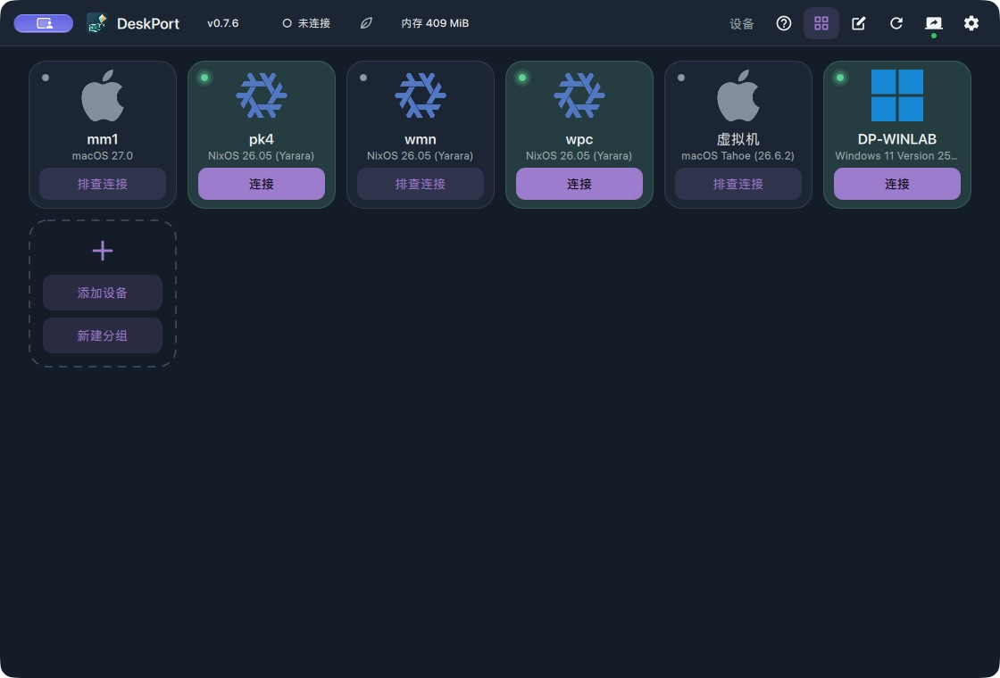
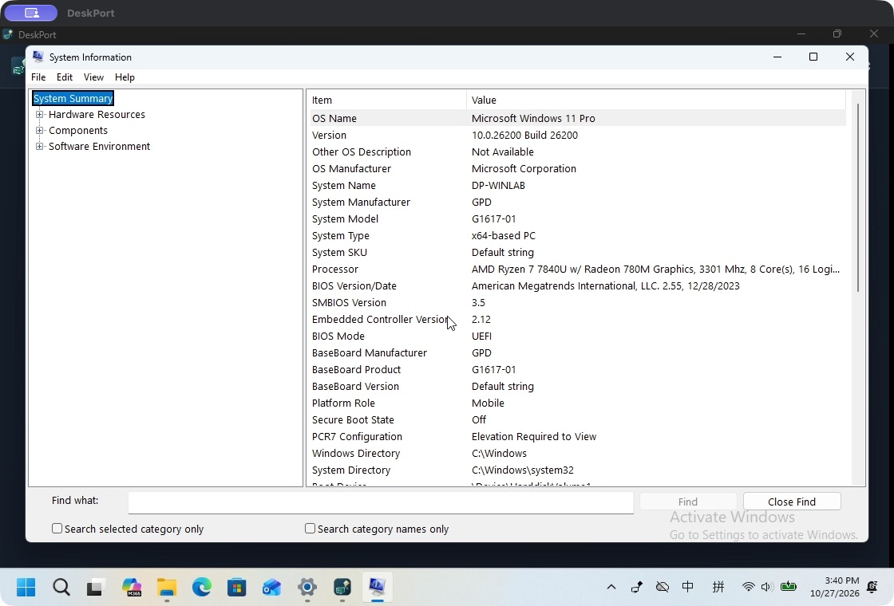
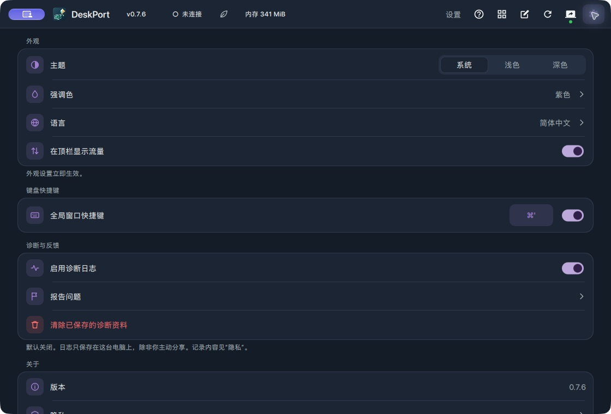
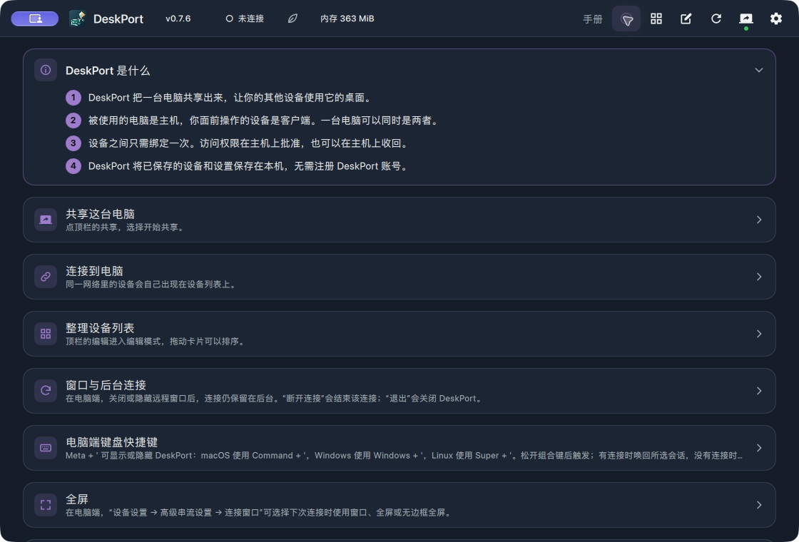

<p align="center">
  
</p>

<h1 align="center">DeskPort</h1>

<p align="center">
  <a href="../../README.md">English</a> ·
  <b>简体中文</b> ·
  <a href="README.zh-TW.md">繁體中文</a> ·
  <a href="README.ja.md">日本語</a> ·
  <a href="README.ko.md">한국어</a> ·
  <a href="README.de.md">Deutsch</a> ·
  <a href="README.es.md">Español</a> ·
  <a href="README.fr.md">Français</a><br>
  <a href="README.pt-BR.md">Português (Brasil)</a> ·
  <a href="README.ru.md">Русский</a> ·
  <a href="README.it.md">Italiano</a> ·
  <a href="README.nl.md">Nederlands</a> ·
  <a href="README.pl.md">Polski</a> ·
  <a href="README.tr.md">Türkçe</a> ·
  <a href="README.uk.md">Українська</a><br>
  <a href="README.ar.md">العربية</a> ·
  <a href="README.hi.md">हिन्दी</a> ·
  <a href="README.id.md">Bahasa Indonesia</a> ·
  <a href="README.ms.md">Bahasa Melayu</a> ·
  <a href="README.th.md">ไทย</a> ·
  <a href="README.vi.md">Tiếng Việt</a> ·
  <a href="README.bo.md">བོད་ཡིག</a>
</p>

<p align="center">
  基于 Moonlight 与 Sunshine 的远程桌面工作区。<br>
  让远程桌面常驻后台，一个动作把它带到当前工作区，
  收起时也无需重新连接。
</p>

<p align="center">
  <a href="https://github.com/keithxc/deskport/releases/tag/v0.7.8"></a>
  <a href="https://apps.apple.com/us/app/deskport/id6812389978"></a>
  <a href="https://github.com/keithxc/deskport/releases/download/v0.7.8/DeskPort-2.7-63.apk"></a>
  <a href="../../LICENSE"></a>
</p>

---

## 主要功能

**0.7.8 正式版：** [发行说明](../releases/RELEASE_0.7.8.md)与
[各版本下载](https://github.com/keithxc/deskport/releases/tag/v0.7.8)。
本版加入面向办公的省流策略、有序备用地址，以及适用于所有主机系统的共享桌面下限。
macOS 桌面输入改由独立主机进程处理。安装包检查及实测范围见发布附带的验证记录。

- **一个桌面应用，既能查看也能共享。** 内置 Sunshine、设备授权、独立凭据与设置；
  macOS、Windows 与 Linux 主机安装包无需另装 Sunshine（仅查看端的 Flatpak 除外）。
- **工作区跟随你的客户端。** 在兼容的 macOS 与 KDE 主机上自适应尺寸，支持 HiDPI、
  移动端横竖屏布局与每设备尺寸设置。调整尺寸时视频会短暂重连，并非无缝的编码器切换。
- **选择主机的显示策略。** 虚拟主屏并镜像其他屏幕、虚拟主屏并关闭其他屏幕，或在符合条件的
  主机上使用扩展工作区。会话结束时 DeskPort 会恢复保存的屏幕布局。
- **在已授权设备之间切换。** 接管正在进行的会话前需要确认；被替换的客户端会收到经过认证的接管说明。
- **桌面工作随手可及。** 隐藏和唤回已连接的查看端，隐藏时释放远程输入，
  并可在不影响本地共享的情况下单独断开查看。
- **每台电脑独立保存设置。** 画面、声音、输入、桌面微调与地址编辑都跟随设备保存；
  支持卡片、置顶、主题和多语言界面。
- **按需共享桌面剪贴板。** 文本即时更新；在已绑定且启用该选项的桌面设备之间，
  受支持的图片与文件按需获取。见[剪贴板范围与限制](../CLIPBOARD.md)。
- **原生移动端控制。** iPhone/iPad 与Android 客户端提供触控/触控板输入、
  键盘控制，并可直接进入远程桌面。
- **可选的登录启动与 macOS 恢复。** 需要处于活动的图形登录会话并获得系统授权；
  它们不会解锁 FileVault，也不会替你登录。

## 界面预览

DeskPort **0.7.6** 在 macOS 上运行，2026-10-27 使用简体中文界面截取。点击可查看大图。

[](../media/devices-macos-076.jpg)

macOS 客户端连接到一台 Windows 11 专业版测试机，显示 Windows「系统信息」：

[](../media/windows-system-information-macos-076.jpg)

| 外观与键盘快捷键 | 内置使用手册 |
| --- | --- |
| [](../media/settings-macos-076.jpg) | [](../media/manual-macos-076.jpg) |

## 支持的平台

当前源码与已安装包的范围、合成器能力、历史验证记录及剩余的原生检查，见
[PC 端实现与验收矩阵](../PC_SUPPORT_MATRIX.md)。下表的发布状态并不代表每项功能在所有 GPU
或系统会话上都经过认证。0.7.8 的验证报告记录了确切的安装包标识与验证范围。

| 平台 | 角色 | 发布状态 | 下载 |
| --- | --- | --- | --- |
| macOS Apple Silicon，macOS 26+ | 查看端 + 主机端 + 原生虚拟显示器 | **0.7.8**；Developer ID 签名与 Apple 公证 | [DMG](https://github.com/keithxc/deskport/releases/download/v0.7.8/DeskPort-0.7.8-macos-arm64.dmg) |
| Linux x86_64 | 查看端 + 主机端；符合条件的 KWin、Mutter 和 Hyprland 主机支持自适应工作区 | **0.7.8**：DEB、RPM、Arch、AppImage、便携包与 Nix | [发布页](https://github.com/keithxc/deskport/releases/tag/v0.7.8) · [安装指南](../LINUX_PACKAGES.md) |
| Linux x86_64 Flatpak | 仅查看端 | **0.7.8**，Freedesktop Platform 25.08 | [发布页](https://github.com/keithxc/deskport/releases/tag/v0.7.8) |
| iPhone / iPad，iOS/iPadOS 15+ | 仅客户端 | 已上架 App Store；较新的版本另在 TestFlight 测试 | [App Store](https://apps.apple.com/us/app/deskport/id6812389978) |
| Android 8.0+ | 仅客户端 | **2.7（构建 63）** · Google Play 封闭测试尚未完成 | [下载 APK](https://github.com/keithxc/deskport/releases/download/v0.7.8/DeskPort-2.7-63.apk) |
| Windows x64 | 查看端 + 主机端 + 虚拟显示器 | **0.7.8**；完整安装包提供主机功能，便携 ZIP 仅为查看端；应用与安装器未签名 | [安装包](https://github.com/keithxc/deskport/releases/download/v0.7.8/DeskPort-0.7.8-windows-x64-setup-full.exe) |
| Linux ARM64 / Intel Mac | 未验证 | 没有经过验证的发布包 | — |

> **Windows 杀毒软件提示：** 杀毒软件有可能将 DeskPort 的 Windows 辅助组件误报为威胁。
> 我们自测时未遇到这种情况。请保持 Defender 开启；如果出现警告，
> 请查看发布附带的验证报告和[样本记录](../WINDOWS_DEVELOPMENT.md#windows-antivirus-notice)。

原生 Linux 包需要 glibc 2.39+：Ubuntu 24.04+/Debian 13+、Fedora 44、
最新的 Arch。AppImage 自带私有运行时，可用于 glibc 较旧的桌面；主机能力仍取决于硬件驱动
与合成器支持。KDE 虚拟显示器主机需要合成器授权条目。原生包与 Nix 包提供固定的条目；
AppImage 与便携版会在开始共享时自动注册当前显示助手的路径。主机输入仍需要设备权限。
移动应用不能作为桌面主机。
仅有包定义或能编译成功，并不代表该平台受支持。

## 安装

**0.7.8：** 从 [0.7.8 发布页](https://github.com/keithxc/deskport/releases/tag/v0.7.8)
下载适合你平台的安装包。设备列表、连接控制与远程桌面共用一个常驻窗口。
在「设置」中配置全局唤回快捷键。安装包检查及其范围见[发行说明](../releases/RELEASE_0.7.8.md)。

**macOS：** 打开 [DMG](https://github.com/keithxc/deskport/releases/download/v0.7.8/DeskPort-0.7.8-macos-arm64.dmg)，
把 DeskPort 拖入「应用程序」后打开。如需使用主机端功能，请授予「屏幕录制」和
「辅助功能」权限。无需 Nix 或 Homebrew。

**Linux：** 选择适合你系统的 [0.7.8 安装包](https://github.com/keithxc/deskport/releases/tag/v0.7.8)，
按照[下方各发行版的步骤](#各发行版的-linux-安装)操作，并完成
[主机输入的前提设置](../LINUX_PACKAGES.md#first-connection-and-hosting)。
使用 Nix：`nix run --refresh github:keithxc/deskport/v0.7.8`。
Flatpak 仅提供查看功能。发布文件附有 [SHA-256 校验和](https://github.com/keithxc/deskport/releases/download/v0.7.8/SHA256SUMS.txt)、[验证报告](https://github.com/keithxc/deskport/releases/download/v0.7.8/VERIFICATION.txt)与 [Linux 安装包验证记录](https://github.com/keithxc/deskport/releases/download/v0.7.8/VERIFICATION-linux.txt)。

**Android 2.7（构建 63）** · Google Play 正式上架所需的封闭测试尚未完成，目前可从 GitHub 临时下载 [APK](https://github.com/keithxc/deskport/releases/download/v0.7.8/DeskPort-2.7-63.apk)。移动客户端不开源，这里仅提供安装包。

构建 63 使用 Google Play 的应用签名，今后可直接用更高版本的 Play 版覆盖安装，保留配对和设置。如果已安装 GitHub 构建 62，首次切换到 63 需先卸载旧版。卸载会清除本地设置，安装后需重新配对电脑。

**iPhone / iPad：** 从 [App Store 安装 DeskPort](https://apps.apple.com/us/app/deskport/id6812389978)。
移动应用为一次性付费购买，当地价格以你所在地区的商店为准。
桌面版始终免费并保持开源。你的购买会用于代码签名、测试设备和后续开发。

在主机上开始共享，在客户端上选择该主机，然后在主机上批准该设备。两台设备之间需要网络可达：
使用局域网或你自己的 VPN（如 Tailscale）。DeskPort 不提供账号服务、托管桌面、中继
或网络隧道。旧版 Sunshine PIN 配对仍然可用。

**浏览器访问：** 桌面主机提供 HTTPS 远程桌面，支持 30 秒登录码、可选的七天浏览器配对、
自适应尺寸和全屏。见 [0.7.1 发行说明](../releases/RELEASE_0.7.1.md)与
[浏览器使用指南](../BROWSER_ACCESS.md)。AppImage 内含私有的 glibc 运行时；
原生包仍需要 glibc 2.39。

更早版本（0.7.3、0.7.2 及其候选版）的变更与验证范围，见各自的发行说明：
[0.7.3](../releases/RELEASE_0.7.3.md)、[0.7.2](../releases/RELEASE_0.7.2.md)、
[0.7.2-rc.1](../releases/RELEASE_0.7.2-rc.1.md)、[0.7.2-rc.2](../releases/RELEASE_0.7.2-rc.2.md)。

### 各发行版的 Linux 安装

以下步骤面向 **x86_64** 桌面系统与 **0.7.8** 发布下载。原生包需要 glibc 2.39 或更高版本。
这些是上游直接下载的文件，而非来自 DeskPort 发行版软件仓库的包；以后的版本需要重新下载并校验。

完整虚拟机中的安装、升级、回滚、卸载与配置保留结果，记录在
[桌面生命周期矩阵](../LINUX_DESKTOP_ACCEPTANCE.md)中。AppImage 的 GUI 冒烟检查不能证明原生包的
安装操作；安装成功和能打开界面，也不能证明实时采集、硬件视频解码、远程输入、画质或延迟。
在 0.7.7 的隔离画布测试中，Omarchy 进行到第 11 个阶段后，遇到与 0.7.6 对照组相同的全屏恢复限制；
这不是实体输入或真实串流测试。见 [0.7.7 Linux 验证记录](https://github.com/keithxc/deskport/releases/download/v0.7.7/VERIFICATION-linux.txt)。

| 发行版 / 桌面 | 下载方式 |
| --- | --- |
| Ubuntu 26.04 GNOME | 0.7.8 DEB 或 AppImage；GNOME 采集/恢复仍有已知缺口 |
| Debian 13 KDE | DEB，用 APT 安装 |
| Fedora 44 KDE | RPM，用 DNF 安装 |
| Arch Linux KDE | 本地 Arch 包，用 `pacman -U` 安装 |
| Bazzite KDE | 0.7.8 AppImage |
| Omarchy / Hyprland | 本地 Arch 包，用 `pacman -U` 安装 |

在你平时使用的桌面会话中打开终端。下面每组命令都会先用该版本的 `SHA256SUMS.txt`
核对下载文件名，校验结果必须对该文件名显示 `OK`；缺少条目或不一致都会中止后续步骤。
安装后以普通用户身份启动 DeskPort。
升级前，先停止共享，并通过托盘菜单等处的 **Quit** 完全退出旧的 DeskPort；仅关闭窗口可能只是隐藏。
之后再启动新安装的版本，确保运行的是新程序。

从更早的版本升级或重新安装 0.7.8 时，使用下面的下载。已有的 DeskPort 设置与配对身份会保留。
安装前请核对确切的文件名与校验和。

<details>
<summary><strong>Ubuntu 26.04 GNOME</strong> — 下载、安装、更新与卸载</summary>

下载 [deskport_0.7.8_amd64.deb](https://github.com/keithxc/deskport/releases/download/v0.7.8/deskport_0.7.8_amd64.deb)，
然后在该文件所在目录打开终端：

```sh
curl --fail --location --output SHA256SUMS.txt https://github.com/keithxc/deskport/releases/download/v0.7.8/SHA256SUMS.txt &&
awk '$2 == "deskport_0.7.8_amd64.deb" { print }' SHA256SUMS.txt | sha256sum --check - &&
sudo apt update &&
sudo apt install --reinstall ./deskport_0.7.8_amd64.deb &&
deskport
```

APT 会从你配置的 Ubuntu 软件源安装依赖。开头的 `./` 表示使用下载的文件。以后可从应用菜单启动。
升级时下载下一个兼容的 DEB，核对校验和后，用其实际文件名执行 `sudo apt install ./NEW_FILENAME.deb`。
卸载：`sudo apt remove deskport`。

Ubuntu 24.04 同样满足原生包的 glibc 要求。Ubuntu 22.04 需要使用 AppImage、仅查看端的 Flatpak，
或单独支持的 Nix/源码构建。GNOME 主机功能取决于已安装的 Mutter 与采集能力；见
[自适应显示要求](../LINUX_ADAPTIVE_DISPLAY.md)。

</details>

<details>
<summary><strong>Debian 13 KDE</strong> — 下载、安装、更新与卸载</summary>

下载 [deskport_0.7.8_amd64.deb](https://github.com/keithxc/deskport/releases/download/v0.7.8/deskport_0.7.8_amd64.deb)，
然后在下载目录打开终端：

```sh
curl --fail --location --output SHA256SUMS.txt https://github.com/keithxc/deskport/releases/download/v0.7.8/SHA256SUMS.txt &&
awk '$2 == "deskport_0.7.8_amd64.deb" { print }' SHA256SUMS.txt | sha256sum --check - &&
sudo apt update &&
sudo apt install --reinstall ./deskport_0.7.8_amd64.deb &&
deskport
```

APT 会解析依赖。以后可从应用菜单启动。升级时下载并核对下一个兼容的 DEB，再用
`sudo apt install ./NEW_FILENAME.deb` 安装。卸载：`sudo apt remove deskport`。
Debian 12 不满足原生包的 glibc 要求；请使用 AppImage、仅查看端的 Flatpak 或受支持的 Nix/源码构建。
Debian 13 的 KWin 6.3 低于主机显示助手要求的 6.6。

作为 KDE 主机使用前，请检查[合成器与输入要求](../LINUX_PACKAGES.md#first-connection-and-hosting)。

</details>

<details>
<summary><strong>Fedora 44 KDE</strong> — 下载、安装、更新与卸载</summary>

下载 [deskport-0.7.8.x86_64.rpm](https://github.com/keithxc/deskport/releases/download/v0.7.8/deskport-0.7.8.x86_64.rpm)，
然后在下载目录打开终端：

```sh
curl --fail --location --output SHA256SUMS.txt https://github.com/keithxc/deskport/releases/download/v0.7.8/SHA256SUMS.txt &&
awk '$2 == "deskport-0.7.8.x86_64.rpm" { print }' SHA256SUMS.txt | sha256sum --check - &&
if [ "$(rpm -q --queryformat '%{VERSION}' deskport 2>/dev/null)" = 0.7.8 ]; then
  sudo dnf reinstall ./deskport-0.7.8.x86_64.rpm
else
  sudo dnf install ./deskport-0.7.8.x86_64.rpm
fi &&
deskport
```

DNF 会从已启用的 Fedora 软件源解析依赖。以后可从应用菜单启动。升级时下载并核对下一个兼容的 RPM，
再用 `sudo dnf install ./NEW_FILENAME.rpm` 安装。卸载：`sudo dnf remove deskport`。
此方式面向常规 Fedora；Bazzite 请按 AppImage 的步骤操作。
作为 KDE 主机使用前，也请检查[合成器与输入要求](../LINUX_PACKAGES.md#first-connection-and-hosting)。

</details>

<details>
<summary><strong>Arch Linux KDE</strong> — 下载、安装、更新与卸载</summary>

先按平时的方式完整更新 Arch 系统，然后下载
[deskport-0.7.8-x86_64.pkg.tar.zst](https://github.com/keithxc/deskport/releases/download/v0.7.8/deskport-0.7.8-x86_64.pkg.tar.zst)。
在下载目录打开终端：

```sh
curl --fail --location --output SHA256SUMS.txt https://github.com/keithxc/deskport/releases/download/v0.7.8/SHA256SUMS.txt &&
awk '$2 == "deskport-0.7.8-x86_64.pkg.tar.zst" { print }' SHA256SUMS.txt | sha256sum --check - &&
sudo pacman -U ./deskport-0.7.8-x86_64.pkg.tar.zst &&
deskport
```

`pacman -U` 安装本地包，并从已配置的软件源解析依赖。以后可从应用菜单启动。以后下载的包核对校验和后，
用 `sudo pacman -U ./NEW_FILENAME.pkg.tar.zst` 安装。卸载：`sudo pacman -R deskport`。
这个下载不会把 DeskPort 加入官方仓库或 AUR。
作为 KDE 主机使用前，也请检查[合成器与输入要求](../LINUX_PACKAGES.md#first-connection-and-hosting)。

</details>

<details>
<summary><strong>Bazzite KDE</strong> — AppImage、开机启动与移除</summary>

下载
[DeskPort-0.7.8-x86_64.AppImage](https://github.com/keithxc/deskport/releases/download/v0.7.8/DeskPort-0.7.8-x86_64.AppImage)。
先停止共享，并用 **Quit** 完全退出旧的 DeskPort；仅关闭窗口可能仍在后台运行。
启用登录启动前，先把新的 AppImage 放到固定位置：

```sh
mkdir -p "$HOME/Applications/DeskPort" &&
cd "$HOME/Applications/DeskPort" &&
curl --fail --location --output DeskPort-0.7.8-x86_64.AppImage https://github.com/keithxc/deskport/releases/download/v0.7.8/DeskPort-0.7.8-x86_64.AppImage &&
curl --fail --location --output SHA256SUMS.txt https://github.com/keithxc/deskport/releases/download/v0.7.8/SHA256SUMS.txt &&
awk '$2 == "DeskPort-0.7.8-x86_64.AppImage" { print }' SHA256SUMS.txt | sha256sum --check - &&
chmod +x DeskPort-0.7.8-x86_64.AppImage &&
./DeskPort-0.7.8-x86_64.AppImage
```

正常启动即可，无需删除或移动其中捆绑的库。如果登录启动仍指向旧的 AppImage，
请在最终路径打开新文件并刷新登录启动。在表中其他 x86_64 发行版上使用 AppImage 时，
也按这些步骤操作，而不是安装原生包。

Bazzite 的 [AppImage 指南](https://docs.bazzite.gg/Installing_and_Managing_Software/AppImage/)
介绍了用 Gear Lever 集成到应用菜单。如果集成工具移动了文件，之后请从最终位置刷新 DeskPort 的启动项。
升级需要下载并核对新的 AppImage。移除时，先关闭 DeskPort 登录启动并退出 DeskPort，
再删除文件，并通过创建菜单项的集成工具移除它。桌面共享请直接在 Bazzite 主机上运行 AppImage；
在 Distrobox 中安装并不能获得主机桌面集成。下方的 Flatpak 仅提供查看功能。

</details>

<details>
<summary><strong>Omarchy / Hyprland</strong> — 本地 Arch 包与主机要求</summary>

先完成 Omarchy 的常规系统更新，然后下载
[deskport-0.7.8-x86_64.pkg.tar.zst](https://github.com/keithxc/deskport/releases/download/v0.7.8/deskport-0.7.8-x86_64.pkg.tar.zst)。
在下载目录打开终端：

```sh
curl --fail --location --output SHA256SUMS.txt https://github.com/keithxc/deskport/releases/download/v0.7.8/SHA256SUMS.txt &&
awk '$2 == "deskport-0.7.8-x86_64.pkg.tar.zst" { print }' SHA256SUMS.txt | sha256sum --check - &&
sudo pacman -U ./deskport-0.7.8-x86_64.pkg.tar.zst &&
deskport
```

以后从应用启动器启动。升级时下载并核对下一个本地 Arch 包，再用
`sudo pacman -U ./NEW_FILENAME.pkg.tar.zst` 安装。卸载：`sudo pacman -R deskport`。
Omarchy 的软件仓库/AUR 包菜单不会把这个 GitHub 下载变成仓库包。

Hyprland 主机使用专用的无头输出。在显示器标识与运行状态可以安全恢复时，
支持镜像、关闭其他屏幕与扩展三种策略；见 [Hyprland 显示租约](../HYPRLAND_DISPLAY.md)。
活动合成器、采集权限与 SSH 服务要求见 [Omarchy/Hyprland 主机指南](../CLI.md#omarchy-and-hyprland)。
套用权限语法前先确认已安装的 Hyprland 版本。仅安装软件包并不会配置无人值守的桌面登录，也不能证明串流可用。

</details>

<details>
<summary><strong>Flatpak 备选</strong> — 仅查看端，适用于已配置 Flatpak 的系统</summary>

下载 [DeskPort-0.7.8-client-x86_64.flatpak](https://github.com/keithxc/deskport/releases/download/v0.7.8/DeskPort-0.7.8-client-x86_64.flatpak)，
然后在下载目录打开终端：

```sh
curl --fail --location --output SHA256SUMS.txt https://github.com/keithxc/deskport/releases/download/v0.7.8/SHA256SUMS.txt &&
awk '$2 == "DeskPort-0.7.8-client-x86_64.flatpak" { print }' SHA256SUMS.txt | sha256sum --check - &&
flatpak install --user --reinstall ./DeskPort-0.7.8-client-x86_64.flatpak &&
flatpak run io.github.keithxc.DeskPort
```

本地包可能会下载 Freedesktop Platform 25.08 运行时。它只提供查看功能，没有 Sunshine 主机功能，
也不集成桌面登录服务。以后下载的包核对校验和后，用
`flatpak install --user --or-update ./NEW_FILENAME.flatpak` 安装。卸载：
`flatpak uninstall --user io.github.keithxc.DeskPort`。这是 GitHub 发布包，安装不依赖 Flathub 上架。

</details>

作为主机使用时，请在正常登录的图形会话中运行，并配置好
[采集与输入的前提条件](../LINUX_PACKAGES.md#first-connection-and-hosting)。
启用可选的登录启动前，先在目标局域网或 VPN 上用客户端测试共享。安装软件包不会配置网络可达性，
也不会授予主机输入权限。卸载前先停止共享并退出 DeskPort，并关闭你启用过的登录启动。
卸载软件包会保留主目录中的 DeskPort 设置。

### Linux 软件仓库状态

| 渠道 | 状态 | 安装方式 |
| --- | --- | --- |
| GitHub 发布包 | 0.7.8 | 在上方下载适合你发行版的安装包 |
| 上游 Nix flake | 0.7.8 | `nix run --refresh github:keithxc/deskport/v0.7.8` |
| AUR `deskport-bin` | 配方已测试；因 AUR 暂停新账号注册而无法发布 | [在本地构建配方](../LINUX_PACKAGES.md#arch-linux-and-aur) |
| Nixpkgs `deskport` | 已提交 [PR #572043](https://github.com/NixOS/nixpkgs/pull/572043) 等待审核；尚未合并 | 合并前请使用上游 flake |
| Arch 官方仓库 / Flathub | 未收录 | 使用发布页下载；Flatpak 仅为查看端 |

可下载的 Arch 包用 `pacman -U` 安装，并不意味着可以使用
`pacman -S deskport`。同样，上游 flake 也不会让 Nixpkgs 中出现
`pkgs.deskport`。主机输入、采集权限与防火墙设置独立于应用安装之外；见
[Linux 安装指南](../LINUX_PACKAGES.md#nixos-and-nix)。

## 同类产品对比

这是工作流程与平台的对比，依据所链接的官方文档于 **2026-09-20** 核对，
并非延迟或画质测试。各产品的功能与平台限制可能会变化。

| 方面 | DeskPort | Moonlight + Sunshine | RustDesk | Parsec |
| --- | --- | --- | --- | --- |
| 主要工作流程 | 持续的远程桌面工作区、自适应尺寸与跨设备接管 | 通过独立的客户端与主机应用进行游戏/桌面串流 | 通用远程控制与支持 | 交互式远程桌面与协作 |
| 桌面主机平台 | macOS Apple Silicon、Linux x86_64 与 Windows x64 | Windows、macOS、Linux 与 FreeBSD，受各平台限制 | Windows、macOS 与 Linux | Windows 与 macOS；Linux 不能作为主机 |
| 桌面客户端 | macOS Apple Silicon、Linux x86_64 与 Windows x64 | Windows、macOS、Linux 等 | Windows、macOS 与 Linux | Windows、macOS、Linux 与受支持的 Chromium 浏览器 |
| 移动客户端 | iPhone/iPad（App Store）· Android（GitHub APK） | iOS/iPadOS 与 Android | iOS/iPadOS 与 Android；iOS 不能作为主机 | Android；无 iOS/iPadOS 客户端 |
| 配置方式 | 原生桌面包内置主机；在 DeskPort 中批准设备 | 单独安装并配置 Sunshine，再与 Moonlight 配对 | 公共服务器或自建服务器 | Parsec 账号与应用 |
| 网络/服务模式 | 自备局域网/VPN 可达性；无 DeskPort 中继 | 自建串流；自行配置网络可达性 | 公共服务或自建 OSS/Pro 服务器 | Parsec 账号/服务体系 |
| 源码与分发 | GPL 桌面版，桌面安装包免费；付费 Apple 应用单独分发 | 开源客户端与主机端 | 开源客户端与 OSS 服务器；另有商业 Pro 服务器 | 专有应用/服务 |

来源：[Moonlight](https://moonlight-stream.org/)、
[Sunshine installation and platform support](https://docs.lizardbyte.dev/projects/sunshine/latest/md_docs_2getting__started.html)、
[RustDesk clients](https://rustdesk.com/docs/en/client/)、
[RustDesk self-hosting](https://rustdesk.com/docs/en/self-host/)、
[Parsec platform compatibility](https://support.parsec.app/hc/en-us/articles/32381568346644-Hardware-and-Software-Compatibility)、
[Parsec Linux setup](https://support.parsec.app/hc/en-us/articles/32381552552340-Install-Parsec-App-on-Linux)。
DeskPort 当前的平台限制见上文；本表并不意味着各操作系统功能完全一致，
也不代表经过测量的性能优势。

参见 [0.7.8 发行说明](../releases/RELEASE_0.7.8.md)、
[架构说明](../ARCHITECTURE.md)与[路线图](../ROADMAP.md)。

## 在 Linux 上构建与运行

启用 Nix 与 flakes 后：

```sh
git clone https://github.com/keithxc/deskport.git
cd deskport
git submodule update --init shared/deskport-core
run="local-$(date -u +%Y%m%dT%H%M%SZ)"
bash scripts/build.sh build --target linux-nix --run "$run"
work=$(DESKPORT_RUN_ID="$run" DESKPORT_TARGET=linux-nix bash scripts/build-paths.sh work)
"$work/result/bin/deskport"
```

查看端的第三方源码依赖已内置（vendored）；共享核心与 Nix 构建输入仍为锁定的外部依赖。
原生构建需要初始化 `shared/deskport-core`。见 [docs/VENDORED.md](../VENDORED.md)。
SSH 设置、本地主机管理、VPS 前提条件以及 Omarchy/Hyprland 请参阅
[命令行指南](../CLI.md)。`deskport doctor` 检查主机运行的前提条件；
`deskport status --json` 无需打开窗口即可查看正在运行的实例。
`nix run . -- --help` 会列出命令行接口。连接前先在主机上开始共享并绑定设备。旧版
Sunshine PIN 配对同样可用。本项目不包含、也不会从 Moonlight 导入任何个人主机或配对凭据。
新建的手动地址默认使用 DeskPort 的端口 `48989`。如果不同，请填写主机共享页面上显示的端口；
若要显式连接默认的独立 Sunshine 安装，可使用 `host:47989`。已保存或发现的端点保留各自的端口。

可编辑的原生构建，编译输出放在源码目录之外：

```sh
git submodule update --init shared/deskport-core
nix develop
source_checkout="$PWD"
native_work="$(bash scripts/build-paths.sh checkout)/native-linux/work"
mkdir -p "$native_work"
cd "$native_work"
qmake "$source_checkout/moonlight-qt.pro" CONFIG+=disable-prebuilts
make -j4
./app/deskport
```

上游项目的文件名保持不变，以便这个分支仍然易于审阅。
macOS、Windows 与 Linux 的打包见[受管构建、签名与清理命令](../BUILD_WORKFLOW.md)。
生成的文件放在源码目录之外，可复用的依赖有独立缓存，完成 GitHub 交付后可用一条命令验证并清理。
签名示例只包含占位符。

## 与 Moonlight 有何不同？

- 内置 Sunshine 主机端，支持设备授权、接管与每设备设置。
- 查看端隐藏时会话保持连接；可从托盘/菜单栏唤回。
- 桌面主机提供 HTTPS 浏览器访问。
- 独立的 `deskport` 可执行文件、`DeskPort` Qt 设置命名空间，以及
  `io.github.keithxc.DeskPort` Linux 应用 ID。
- 默认窗口化串流与绝对指针控制。
- 失去焦点时静音；默认关闭游戏优化、手柄鼠标、多手柄模式、后台手柄输入与 Discord 状态。
- 这个独立应用不会出现上游 Moonlight 的更新提示。
- 锁定的 Nix 环境与一套 Linux 构建流程。

桌面界面提供设备、共享与设置页面，包含语言选择与独立的主机权限。关闭查看端会保留其会话
并打开设备列表。处于活动状态的设备会提供「返回桌面」，其他设备在当前会话断开前只显示详情。
可以置顶常用设备，并在紧凑列表与卡片之间切换。外观跟随系统，也可强制浅色或深色。

## 平台范围

各平台的发布状态见上方的[平台表](#支持的平台)。桌面版覆盖 macOS Apple Silicon、Linux x86_64
与 Windows x64，均可作为查看端和主机端；移动应用仅为客户端。

客户端平台支持与主机端支持是相互独立的：Mac 主机并不要求使用 DeskPort 的 Mac 客户端。
硬件解码、实时输入、画质与唤回延迟都需要真实会话测试，构建成功并不能说明这些。

## 下一个里程碑

让一个会话在 **50 次隐藏/显示循环**中保持连接，把窗口显示在当前工作区，并可靠地交还本地输入。
新画面延迟与后台资源占用要与窗口出现时间分开测量。

验收标准与延后的功能见[路线图](../ROADMAP.md)，来源与维护边界见
[上游说明](../UPSTREAM.md)。

## 验证

```sh
run="check-$(date -u +%Y%m%dT%H%M%SZ)"
bash scripts/build.sh build --target linux-nix --run "$run"
```

冒烟检查使用临时的 XDG 配置/缓存目录与离屏 Qt 平台。它不会与主机配对、启动串流或注入输入。

## 日常桌面操作

关闭窗口后 DeskPort 仍在托盘/菜单栏运行。用 **Open DeskPort** 唤回它，用 **Disconnect viewer** 只结束
当前连接，或用 **Quit DeskPort** 结束整个服务。查看端关闭时，本地共享继续运行。

**Meta + '**（单引号）与左键单击托盘图标的作用相同：隐藏前台的查看端、唤回最近的会话，
没有活动会话时则显示或隐藏设备列表。Meta 在 macOS 上是 Command，在 Windows/Linux 上是
Windows/Super 键。应用需要处于运行状态。隐藏时会释放远程输入，连接保持不断。

Wayland 使用桌面的 GlobalShortcuts portal，可能会弹出授权对话框请你批准该绑定，
桌面的快捷键设置也可以覆盖它。X11、Windows 和 macOS 使用各自的原生快捷键 API 注册。
如果快捷键已被占用、键盘布局不受支持或缺少 portal，托盘控制仍然可用，注册失败会写入日志。
DeskPort 不会改写任何系统快捷键配置。隔离运行时可设置 `DESKPORT_DISABLE_GLOBAL_SHORTCUT=1` 跳过注册。

两端绑定设备默认启用纯文本剪贴板共享与系统快捷键捕获。设置更改在重新连接后生效。只共享新的
复制内容，上限 1 MiB。兼容且已启用该选项的桌面设备之间可按需获取受支持的图片与文件；见[限制](../CLIPBOARD.md)。
在桌面指针模式下，键盘路由跟随位于聚焦视频内的指针。
**Ctrl+Alt+Shift+Z** 释放输入；
**Ctrl+Alt+Shift+Q** 断开查看端。显式释放后，点击画面内部即可重新获得输入。
系统保留的快捷键取决于桌面合成器。

登录启动与恢复需要处于活动的图形登录会话。在依赖某台电脑进行无人值守访问之前，请先阅读
[验收检查与限制](../INPUT_SERVICE_ACCEPTANCE.md)。

## 许可与致谢

DeskPort 是 [Moonlight Qt](https://github.com/moonlight-stream/moonlight-qt) 的独立衍生项目，
最初基于 v6.1.0，并非官方的 Moonlight 或 Sunshine 发行版。Moonlight 提供串流基础；
[Sunshine](https://github.com/LizardByte/Sunshine) 被打包进 macOS、Windows 与 Linux 主机包（仅查看端的 Flatpak 除外），
并由 Linux Nix 包提供。单独安装的 Sunshine 服务保持独立。

GPL-3.0-or-later；见 [LICENSE](../../LICENSE)、保留的源码声明，以及
[docs/VENDORED.md](../VENDORED.md) 中列出的每个内置依赖的许可证。原始文档保留在
[README.upstream.md](README.upstream.md)。

### 诊断与反馈

诊断日志默认开启。复现问题后，生成日志 ZIP 并打开 GitHub issue 草稿。附加之前请先检查 ZIP 内容：
GitHub issue 是公开的，DeskPort 不会替你上传或提交任何内容。
见[诊断数据与限制](../DIAGNOSTICS.md)。
